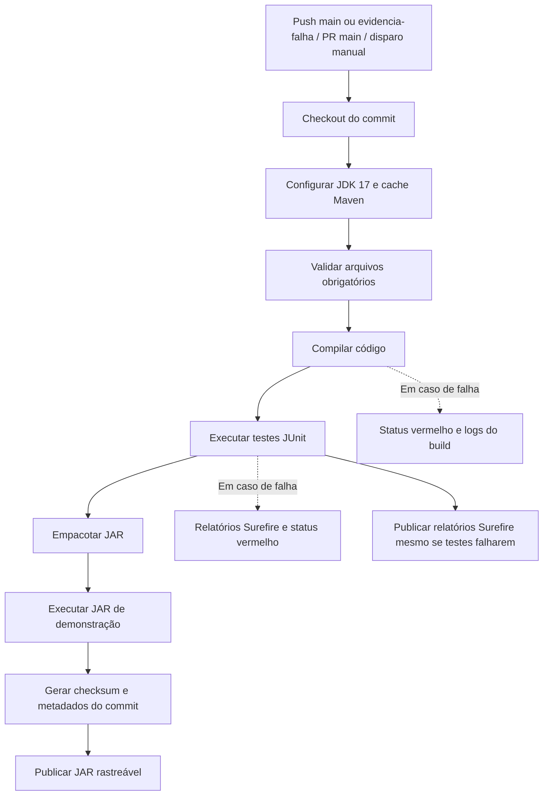

# Arquitetura do Pipeline CI — Biblioteca

## Visão geral

O CI executa automaticamente no GitHub Actions a partir de uma revisão exata do código. O objetivo é **falhar cedo**, guardar evidências e publicar um JAR **apenas se todas as validações obrigatórias passarem**.

## Matriz de etapas

| Etapa | Entrada | Ação | Saída | Condição de falha | Evidência | Responsável |
|---|---|---|---|---|---|---|
| Gatilho | Push, PR ou manual | Iniciar workflow | Execução associada a ref | Evento fora do escopo não inicia | Histórico Actions | Equipe de desenvolvimento |
| Checkout | SHA do commit | Checkout do repositório | Código versionado | Erro de download/acesso | Log checkout e SHA | Equipe + plataforma GitHub |
| Preparação | Runner | Instalar JDK 17, cache Maven | Ambiente de build | Falha de setup | Logs do runner | Equipe + plataforma GitHub |
| Validação | Arquivos | Verificar arquivos obrigatórios | Estrutura confirmada | Arquivo ausente | Log da validação | Desenvolvimento |
| Build | Fontes Java | `mvn ... compile` | Classes compiladas | Erro de compilação | Log Maven | Desenvolvimento |
| Testes | Classes e casos JUnit | `mvn ... test` | Resultado dos testes | Teste falhou/erro | Surefire XML/TXT e log | Desenvolvimento/QA |
| Empacotamento | Classes aprovadas | `mvn ... package` | JAR 1.0.0 | Erro de empacotamento | Log Maven | Desenvolvimento |
| Smoke | JAR | `java -jar ...` | Saída demonstrativa | Processo retorna erro | Log do comando | Desenvolvimento/QA |
| Identificação | JAR + SHA | Calcular hash e gerar metadados | SHA-256, build-info | Arquivo ausente | TXT de metadados | DevOps/equipe |
| Publicação | JAR aprovado + TXT | Upload do artefato | Download no Actions | Falha no upload | Artifact da execução | DevOps/equipe |

**Dependências:** a próxima fase só executa após a anterior passar, exceto a etapa que coleta relatórios de testes, configurada para rodar mesmo após falha (`always()`).

## Gatilhos e políticas

- `push` em `main` e `evidencia-falha`.
- `pull_request` cujo destino é `main`.
- `workflow_dispatch` (ação manual permitida pelo GitHub).
- Nenhum deploy em produção.
- O workflow tem apenas permissão `contents: read`.
- JAR e metadados são publicados apenas quando os comandos anteriores terminam com exit code 0.

## Artefato e rastreabilidade

- Arquivo: `target/biblioteca-ci-1.0.0.jar`.
- Nome no Actions: `biblioteca-jar-<SHA do commit>`.
- `build-info.txt`: repo, SHA, ref e URL da execução.
- `checksum-sha256.txt`: hash do arquivo distribuído.
- Relatórios: XML e TXT em `target/surefire-reports/` quando os testes JUnit executam.
- O JAR gerado em cada execução é identificado pelo commit e não é recompilado por ambiente (não existe deploy neste trabalho).

## Riscos e mitigações

| Risco | Impacto | Mitigação |
|---|---|---|
| Testes incompletos | Defeitos passam despercebidos | Cobrir cenários válidos e inválidos com JUnit; revisar testes a cada nova regra |
| Falha de dependência ou Maven Central indisponível | Build não conclui | Declarar versões e habilitar cache Maven; repetir após normalização da rede |
| Segredo publicado acidentalmente | Exposição de credenciais | Não incluir segredos em commits; `.gitignore`, permissões mínimas, revisão de PR e secrets protegidos se futuramente necessários |
| JAR sem identidade única | Dificuldade para rastrear ou recuperar | Nome do upload inclui SHA do commit; `build-info` e SHA-256 |
| Build local diferente do CI | Erros encontrados tarde | Java 17 no workflow e no `pom.xml`; build automatizado em ambiente limpo |
| Workflow com permissões excessivas | Maior superfície de ataque | Declarar `permissions: contents: read`; não usar segredos |
| Falha de teste ignorada | Artefato incorreto publicado | Testes obrigatórios em etapa própria, sem `continue-on-error`; upload do JAR só ocorre em sucesso |

## Limites intencionais do trabalho

O objetivo é CI: **não há deploy, banco de dados, Kubernetes ou upload para Docker Hub**. Os logs, relatórios e artefatos ficam associados às execuções reais do workflow no GitHub Actions.
